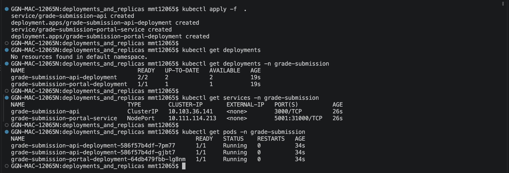

A Deployment in Kubernetes allows us to declaratively manage a set of pods. The two key specifications in a Deployment are the number of pod replicas, and the pod template (defining how each pod should be constructed). This Deployment declares our desired state: 3 replicas of pods based on the specified template:

apiVersion: apps/v1
kind: Deployment
metadata:
  name: my-app
spec:
  replicas: 3
  template:
    spec:
      containers:
      - name: my-app
        image: my-app:v1

Behind the scenes:

The Deployment Controller creates a ReplicaSet based on this specification.

A ReplicaSet is a Kubernetes resource that ensures a specified number of pod replicas are running at all times.

The ReplicaSet Controller watches for ReplicaSet objects and creates pods based on them.

The ReplicaSet Controller continuously monitors the state of the pods.

If a pod terminates or fails, the ReplicaSet Controller automatically creates a new one to maintain the desired number of replicas.

The Deployment Controller manages the overall lifecycle of the Deployment, including updates and rollbacks (discussed in the next section), while the ReplicaSet Controller handles the day-to-day management of pods. This orchestration happens automatically. As developers, we simply declare our desired state in the Deployment object, and Kubernetes handles the rest, ensuring our application remains running as specified.

Type of deployment : RollingUpdate

Without rolling updates, upgrading an application could lead to significant downtime. Imagine a scenario where all pod replicas running v1 of an application are simultaneously taken down and replaced with v2. This would result in a period where no pods are available to serve traffic, causing service interruption. Rolling updates solve this problem by gradually replacing old pods with new ones, ensuring that the application remains available throughout the upgrade process.

How Rolling Updates Work
1.  The process begins when you update the pod template in a Deployment resource. Here's an example:

apiVersion: apps/v1
kind: Deployment
metadata:
  name: grade-submission-api
spec:
  replicas: 3
  template:
    spec:
      containers:
      - name: grade-submission-api
        image: registry/grade-submission-api:v1 # Update to v2

2. The Deployment controller creates a new ReplicaSet for v2 pods while preserving the old ReplicaSet for v1 pods. A ReplicaSet is a Kubernetes resource that ensures a specified number of pod replicas are running at all times.

During a rolling update, the Deployment manages two ReplicaSets:

   ReplicaSet 1 (v1): 3 pods ----> 0 pods
   ReplicaSet 2 (v2): 0 pods ----> 3 pods

3. New v2 pods are created while old v1 pods are gradually terminated. This process continues until all pods are running the new version.

Controlling the Rolling Update
By default, Kubernetes implements a rolling update strategy, but you can control its behavior using two parameters:

maxUnavailable: The maximum number of pods that can be unavailable during the update.

maxSurge: The maximum number of pods that can be created over the desired number of pods.

Here's how you can specify these in your Deployment:

spec:
  strategy:
    type: RollingUpdate
    rollingUpdate:
      maxUnavailable: 1
      maxSurge: 1
With these settings and 3 replicas, you might see output like this during the update:

NAME                                   READY   STATUS
grade-submission-api-7f9dd7f789-2x9p4   1/1     Running
grade-submission-api-7f9dd7f789-9k2xn   1/1     Running
grade-submission-api-7f9dd7f789-qp6g7   1/1     Running
grade-submission-api-6c54bd5869-lmn0p   0/1     ContainerCreating
This output reflects our settings:

All three original pods are running, respecting maxUnavailable: 1.

One new pod is being created, adhering to maxSurge: 1.

As the update progresses:

NAME                                   READY   STATUS
grade-submission-api-7f9dd7f789-2x9p4   1/1     Running
grade-submission-api-7f9dd7f789-9k2xn   1/1     Running
grade-submission-api-7f9dd7f789-qp6g7   0/1     Terminating
grade-submission-api-6c54bd5869-lmn0p   1/1     Running
grade-submission-api-6c54bd5869-3fgh2   1/1     Running
Here, we see:

One old pod terminating (maxUnavailable: 1)

Two new pods running, temporarily giving us 4 pods total (maxSurge: 1)

At least 2 pods always fully running, ensuring minimal disruption

This process continues until all pods are updated to the new version.

Rollbacks
If issues arise with the new version, Kubernetes makes rollbacks easy. The old ReplicaSet (v1) is kept, allowing for quick reversion. During a rollback:

1. The v2 ReplicaSet is scaled down to 0 pods.

2. A new ReplicaSet based on the v1 configuration is created and scaled up to the desired number of replicas.

3. This process also uses a rolling update strategy, ensuring minimal downtime during the rollback.

ReplicaSet 1 (v1): 3 pods ----> 0 pods
ReplicaSet 2 (v2): 3 pods ----> 0 pods
ReplicaSet 3 (v1): 0 pods ----> 3 pods

Benefits of Rolling Updates
1. Minimal Downtime: By gradually replacing pods, the application remains available throughout the update process.

2. Version Control: Easy rollbacks to previous versions if issues are detected.

3. Traffic Management: Ensures that user traffic is always directed to available pods.